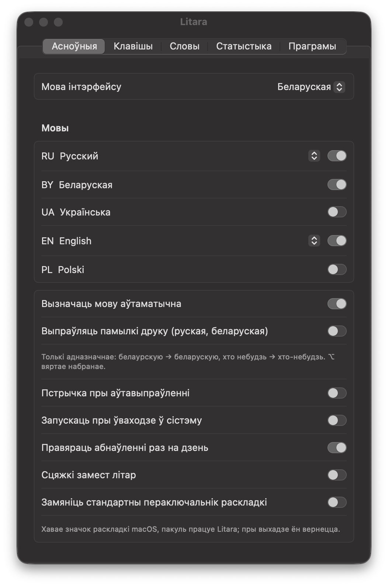
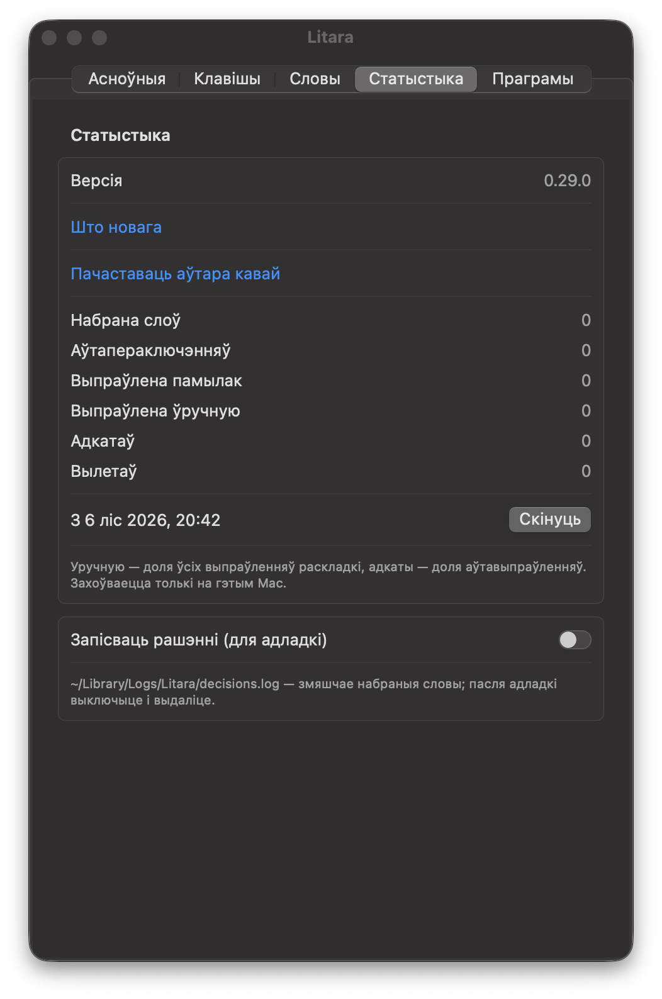

# Litara

[English](README.md) · Беларуская · [Polski](README.pl.md) · [Русский](README.ru.md) · [Українська](README.uk.md)

[](https://github.com/Nugnii/litara/releases/latest)
[](https://www.swift.org/)
[](https://github.com/Nugnii/litara/releases/latest)
[](https://github.com/Nugnii/litara/releases)
[](LICENSE)

Litara выпраўляе на macOS тэкст, набраны не ў той раскладцы, і сама пераключае раскладку. Набралі `ghbdtn`?
Атрымаецца `привет`. Набралі `руддщ`? Атрымаецца `hello`. Мовы: беларуская, украінская, польская, руская і
англійская. Бясплатная праграма з адкрытым кодам (GPL-3.0).

**[⬇️ Спампаваць Litara для macOS](https://github.com/Nugnii/litara/releases/latest/download/Litara.dmg)** — macOS 13 або
навейшая, Apple Silicon і Intel.

<p>
</p>

## ✨ Што ўмее

- **Выпраўляе раскладку падчас набору.** З трэцяй літары або па прабеле слова, якое не мае сэнсу ў бягучай
  раскладцы, але ёсць у іншай, перадрукоўваецца ў той раскладцы, і раскладка пераключаецца.
- **⌥ (націснуць і адпусціць)** — выправіць апошняе слова або вылучаны тэкст; яшчэ раз — наступная раскладка.
  **⌥⇧** — наступная раскладка. Змену рэгістра і трансліт можна прызначыць у наладах; кожнае спалучэнне
  мяняецца.
- **Адмена** — ⌥ адразу пасля выпраўлення вяртае набранае. Слова, выпраўленне якога адменена тры разы, больш не
  выпраўляецца і трапляе ў «Мае словы».
- **Выпраўляе памылкі друку** (руская і беларуская, па змаўчанні выключана): толькі адназначныя — `руский` →
  `русский`, `хто небудзь` → `хто-небудзь`.
- **Вучыць вашы словы.** «Навучыць словам з тэкстаў…» чытае вашы ўласныя тэксты (напрыклад, экспарт чата), каб
  пазнаваць імёны, жаргон і ваш слоўнік; словы, якія вы часта набіраеце, вывучаюцца самі. Вывучаныя словы можна
  экспартаваць і імпартаваць.
- **Мае словы, свае замены, праграмы** — словы, якія ніколі не выпраўляюцца, вашы замены і праграмы, дзе Litara
  сама нічога не выпраўляе.
- **Статыстыка** — набрана слоў, аўтапераключэнняў, выпраўлена памылак друку, выпраўлена хоткеем, адмен.
  Захоўваецца толькі на вашым Mac.
- Значок у радку меню паказвае бягучую мову (літарамі або сцяжкамі — як захочаце); інтэрфейс — па-беларуску,
  па-англійску, па-польску, па-руску і па-ўкраінску.

## 🧠 Як гэта працуе

1. **Раскладкі бяруцца з macOS.** Litara чытае раскладкі клавіятуры, усталяваныя на вашым Mac, і ведае, што друкуе
   кожная клавіша ў кожнай з іх. Нічога не зашыта ў код.
2. **Слоўнікі ўнутры праграмы.** Слоўнікі Hunspell для пяці моў плюс імёны і назвы месцаў з Wikidata спакаваны ў
   кампактныя фільтры слоў. Ніводнае слова не шукаецца ў сетцы.
3. **Яна бачыць клавішы, а не дакументы.** Пры доступе «Даступнасць» Litara бачыць націскі клавіш і трымае ў памяці
   толькі бягучы сказ. Нічога не запісваецца на дыск і не адпраўляецца.
4. **Вырашае рана.** З трэцяй літары, калі набранае не можа быць пачаткам слова ў бягучай мове, але можа ў роўна
   адной іншай, слова выпраўляецца адразу; інакш Litara чакае прабел. Беларуская, руская і ўкраінская маюць
   большасць агульных клавіш, таму паміж імі вырашаюць слоўнікі кожнай мовы.
5. **Перадрукоўвае націскамі клавіш.** Слова сціраецца Backspace і друкуецца нанова ў патрэбнай раскладцы, потым
   раскладка пераключаецца. Буфер абмену ніколі не чапаецца.
6. **Апошняе слова за вамі.** ⌥ выпраўляе або вяртае набранае; слова, выпраўленне якога вы адмянілі тры разы,
   больш ніколі не выпраўляецца.

### ⚠️ Абмежаванні

- Аўтаматычнае вызначэнне ахоплівае беларускую, англійскую, польскую, рускую і ўкраінскую мовы.
- Палі пароляў ніколі не чапаюцца. Пакуль у macOS уключаны абаронены ўвод — нават калі поле пароля засталося
  адкрытым у фоне — Litara спыняецца і паказвае замок у радку меню.
- У праграмах, дзе сціранне даходзіць пазней за набор (напрыклад, у некаторых эмулятарах Android), Litara тэкст не
  правіць; пераключэнне раскладкі пры гэтым працуе.
- Litara можна выключыць для асобных праграм у «Праграмы».

## 📦 Усталяванне

Патрэбна macOS 13 або навейшая, Apple Silicon або Intel.

1. Спампуйце [Litara.dmg](https://github.com/Nugnii/litara/releases/latest/download/Litara.dmg) (усе версіі — у
   [Releases](https://github.com/Nugnii/litara/releases)) і перацягніце Litara ў «Праграмы». Праграма падпісана і
   праверана Apple (натарызацыя).
2. Адкрыйце Litara. Акно першага запуску папросіць доступ «Даступнасць»: «Сістэмныя налады → Прыватнасць і
   бяспека → Даступнасць», уключыце Litara. Без гэтага macOS не дазваляе праграме бачыць набор.
3. Калі трэба — уключыце ў наладах «Запускаць пры ўваходзе ў сістэму».

Абнаўленні: раз на дзень Litara правярае, ці выйшла новая версія, і прапануе яе ўсталяваць; «Праверыць
абнаўленні…» — у меню.

Пераход з blalb (працоўная назва Litara да 0.29.0): налады, вывучаныя словы і статыстыка пераносяцца пры першым
запуску. Доступ «Даступнасць» трэба даць нанова: у праграмы новы ідэнтыфікатар.

## 🔒 Прыватнасць

- Нічога з набранага не пакідае ваш Mac. Статыстыка і вывучаныя словы захоўваюцца толькі на ім.
- Адзіны зварот у сетку — штодзённая праверка абнаўленняў на GitHub; нічога пра вас і набранае не перадаецца.
  Выключаецца ў «Асноўных».
- Буфер абмену не выкарыстоўваецца ніколі: выпраўленні перадрукоўваюцца націскамі клавіш.
- Палі пароляў не чапаюцца. Пакуль у macOS уключаны абаронены ўвод, на значку ў радку меню — замок.
- «Запісваць рашэнні (для адладкі)» па змаўчанні выключана; журнал застаецца ў `~/Library/Logs/Litara`.

## 🛠 Зборка з зыходнікаў

Патрэбен Xcode са Swift 6.

```sh
swift build
swift test
scripts/bundle.sh          # build/Litara.app, Apple Silicon і Intel
scripts/dmg.sh             # build/Litara-<версія>.dmg
```

`scripts/bundle.sh` падпісвае сертыфікатам Developer ID са звязкі ключоў, калі ён ёсць, інакш — ad hoc. Фільтры
слоў перазбіраюцца са слоўнікаў `scripts/build_dictionaries.sh`.

Раскладкі чытаюцца з macOS, а не зашыты ў код. Патрабаванні — [docs/spec.md](docs/spec.md) (па-руску). Змены —
[CHANGELOG.be.md](CHANGELOG.be.md).

## 📚 Слоўнікі

Мова слова вызначаецца па слоўніках Hunspell — SCOWL (en), слоўнік Аляксандра Лебедзева (ru), SJP.PL (pl), dict_uk
(uk) і беларускі слоўнік з LibreOffice (be) — і па імёнах і назвах месцаў з Wikidata. У кожнага свой файл ліцэнзіі;
крыніцы і ліцэнзіі — [Dictionaries/README.md](Dictionaries/README.md).

## 💬 Сувязь

Пішыце на [litaraby@gmail.com](mailto:litaraby@gmail.com) або адкрывайце
[issue](https://github.com/Nugnii/litara/issues).

Калі Litara вам карысная, можна [пачаставаць аўтара кавай](https://buycoffee.to/stugka).

## 📄 Ліцэнзія

Copyright (C) 2026 Kanstantsin Berseneu

Гэта свабодная праграма: яе можна распаўсюджваць і змяняць на ўмовах GNU General Public License, апублікаванай Free
Software Foundation, версіі 3 або (на ваш выбар) любой пазнейшай. Глядзіце [LICENSE](LICENSE).
