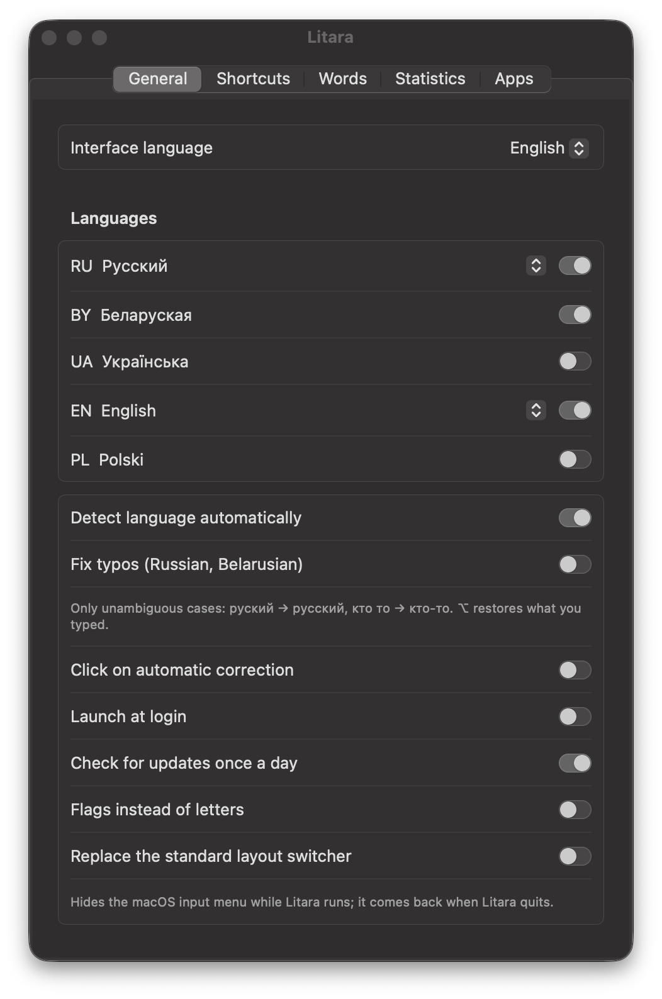
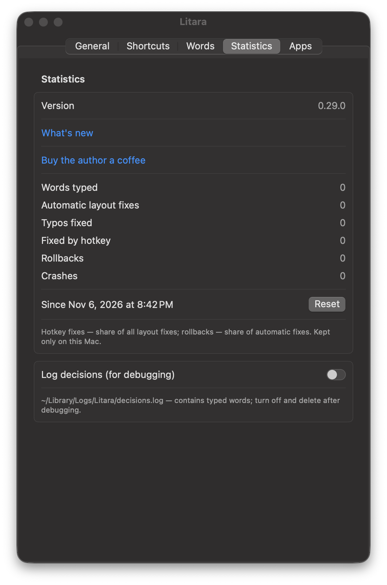

# Litara

English · [Беларуская](README.be.md) · [Polski](README.pl.md) · [Русский](README.ru.md) · [Українська](README.uk.md)

Litara fixes text typed in the wrong keyboard layout on macOS and switches the layout for you. Typed `ghbdtn`?
It becomes `привет`. Typed `руддщ`? It becomes `hello`. Languages: Belarusian, Ukrainian, Polish, Russian and
English. Free and open source (GPL-3.0).

*Litara* is Belarusian for "letter".

<p>
</p>

## What it does

- **Fixes the layout as you type.** From the third letter, or when you press space, a word that makes no sense in the
  current layout but is a real word in another one is retyped in that layout, and the layout is switched.
- **⌥ (press and release)** — fix the last word or the selected text; press again for the next layout.
  **⌥⇧** — next layout. Changing case and transliteration can be assigned in the settings; every shortcut can be
  changed.
- **Undo** — ⌥ right after a correction brings back what you typed. A word you undo three times is no longer
  corrected and goes to *My words*.
- **Fix typos** (Russian and Belarusian, off by default): only unambiguous cases — `руский` → `русский`,
  `кто то` → `кто-то`.
- **Learns your words.** *Learn words from texts…* reads your own texts (for example, a chat export) so names,
  slang and your vocabulary are recognised; words you type often are learned as you go. Learned words can be
  exported and imported.
- **My words, My replacements, Apps** — words that are never corrected, your own replacements, and apps where
  Litara does not correct anything by itself.
- **Statistics** — words typed, automatic fixes, typos fixed, fixes by hotkey, undos. Kept only on your Mac.
- Menu bar icon shows the current language (letters, or flags if you prefer); the interface is in Belarusian,
  English, Polish, Russian and Ukrainian.

## Install

Requires macOS 13 or later, Apple Silicon or Intel.

1. Download `Litara-<version>.dmg` from [Releases](https://github.com/Nugnii/litara/releases) and drag Litara to
   Applications. The app is signed and notarized by Apple.
2. Open Litara. The welcome window asks for **Accessibility** access: *System Settings → Privacy & Security →
   Accessibility*, turn Litara on. Without it macOS does not let an app see typing.
3. Optionally turn on *Launch at login* in the settings.

Updates: once a day Litara checks for a new version and offers to install it; *Check for Updates…* is in
the menu.

Upgrading from blalb (the working name of Litara before 0.29.0): settings, learned words and statistics are moved
over on the first launch. Accessibility has to be granted again because the app has a new identity.

## Privacy

- Nothing you type leaves your Mac. Statistics and learned words are stored only on your Mac.
- The only network request is the daily update check on GitHub; it sends nothing about you or your typing.
  Turn it off in *General*.
- The clipboard is never used: corrections are retyped as key presses.
- Password fields are never touched. While macOS secure input is on, the menu bar icon shows a lock.
- *Log decisions (for debugging)* is off by default; the log stays in `~/Library/Logs/Litara`.

## Build from source

Needs Xcode with Swift 6.

```sh
swift build
swift test
scripts/bundle.sh          # build/Litara.app, Apple Silicon and Intel
scripts/dmg.sh             # build/Litara-<version>.dmg
```

`scripts/bundle.sh` signs with a Developer ID certificate from your keychain if there is one, otherwise ad hoc.
Word filters are rebuilt from the dictionaries with `scripts/build_dictionaries.sh`.

Keyboard layouts are read from macOS, not hard-coded. Requirements: [docs/spec.md](docs/spec.md) (in Russian).
Changes: [CHANGELOG.md](CHANGELOG.md).

## Dictionaries

Language detection uses Hunspell dictionaries — SCOWL (en), Alexander Lebedev's dictionary (ru), SJP.PL (pl),
dict_uk (uk) and the Belarusian dictionary from LibreOffice (be) — plus names and places from Wikidata. Each has its
own license file; sources and licenses: [Dictionaries/README.md](Dictionaries/README.md).

## Feedback

Write to [litaraby@gmail.com](mailto:litaraby@gmail.com) or open an
[issue](https://github.com/Nugnii/litara/issues).

If Litara is useful to you, you can [buy the author a coffee](https://buycoffee.to/stugka).

## License

Copyright (C) 2026 Kanstantsin Berseneu

This program is free software: you can redistribute it and/or modify it under the terms of the GNU General Public
License as published by the Free Software Foundation, either version 3 of the License, or (at your option) any later
version. See [LICENSE](LICENSE).
