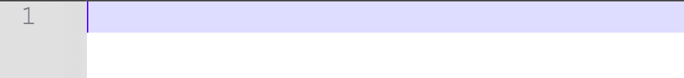
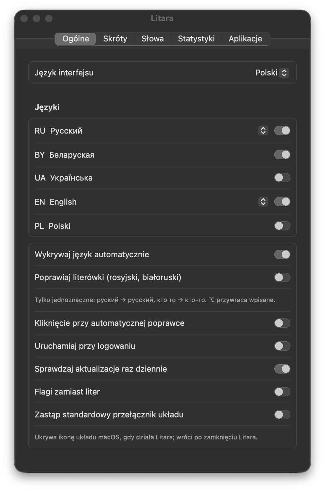
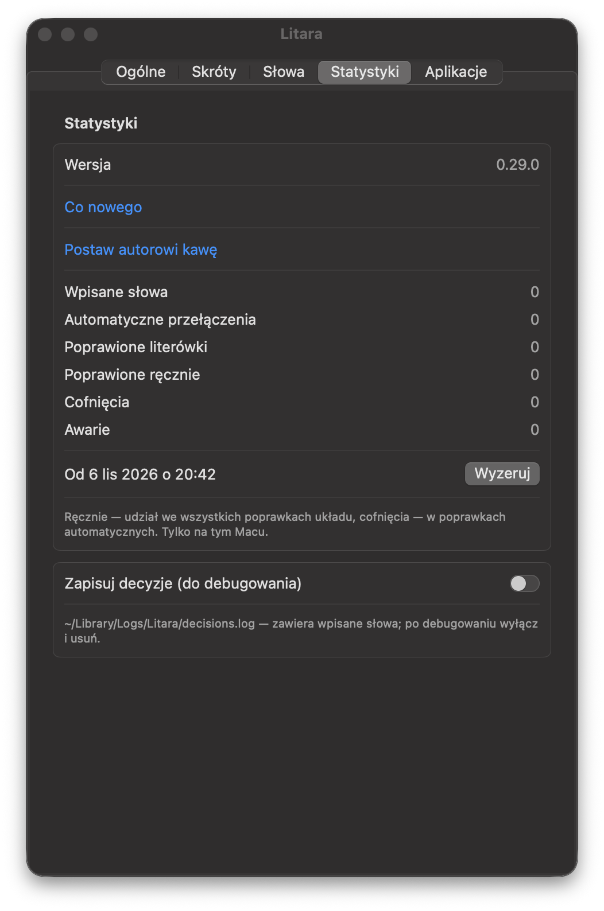

# Litara

[English](README.md) · [Беларуская](README.be.md) · Polski · [Русский](README.ru.md) · [Українська](README.uk.md)

[](https://github.com/Nugnii/litara/releases/latest)
[](https://www.swift.org/)
[](https://github.com/Nugnii/litara/releases/latest)
[](https://github.com/Nugnii/litara/releases)
[](LICENSE)

> Nie piszę bezwzrokowo i zmęczyło mnie poprawianie tekstu wpisanego w złym układzie klawiatury. Istniejące programy
> nie obsługiwały jednak języka białoruskiego i nie miały funkcji, które uważałem za przydatne: przełączały układ tam,
> gdzie nie było to potrzebne, i nie dało się ich porządnie nauczyć. Musiałem zakasać rękawy i to naprawić.

Litara poprawia na macOS tekst wpisany w złym układzie klawiatury i sama przełącza układ. Wpisałeś `ghbdtn`?
Zamieni się w `привет`. Wpisałeś `руддщ`? Zamieni się w `hello`. Języki: białoruski, ukraiński, polski, rosyjski
i angielski. Darmowy program o otwartym kodzie (GPL-3.0).

*Litara* po białorusku znaczy „litera”.

**[⬇️ Pobierz Litarę dla macOS](https://github.com/Nugnii/litara/releases/latest/download/Litara.dmg)** — macOS 13 lub nowszy,
Apple Silicon i Intel.

<p></p>

<p>
</p>

## ✨ Co potrafi

- **Poprawia układ w trakcie pisania.** Od trzeciej litery albo po spacji słowo, które nie ma sensu w bieżącym
  układzie, ale jest prawdziwym słowem w innym, zostaje wpisane ponownie w tamtym układzie, a układ się przełącza.
- **⌥ (naciśnij i puść)** — popraw ostatnie słowo lub zaznaczony tekst; naciśnij jeszcze raz, by przejść do
  następnego układu. **⌥⇧** — następny układ. Zmianę wielkości liter i transliterację można przypisać w ustawieniach;
  każdy skrót da się zmienić.
- **Cofanie** — ⌥ tuż po poprawce przywraca to, co zostało wpisane. Słowo, którego poprawkę cofniesz trzy razy, nie
  jest już poprawiane i trafia do „Moje słowa”.
- **Poprawia literówki** (rosyjski i białoruski, domyślnie wyłączone): tylko jednoznaczne przypadki — `руский` →
  `русский`, `кто то` → `кто-то`.
- **Uczy się twoich słów.** „Naucz słów z tekstów…” czyta twoje własne teksty (na przykład eksport czatu), żeby
  rozpoznawać imiona, slang i twoje słownictwo; słowa, które często wpisujesz, są poznawane na bieżąco. Poznane słowa
  można eksportować i importować.
- **Moje słowa, Własne zamienniki, Aplikacje** — słowa, które nigdy nie są poprawiane, twoje własne zamienniki oraz
  aplikacje, w których Litara sama niczego nie poprawia.
- **Statystyki** — wpisane słowa, automatyczne poprawki, poprawione literówki, poprawki skrótem, cofnięcia.
  Przechowywane wyłącznie na twoim Macu.
- Ikona na pasku menu pokazuje bieżący język (literami albo, jeśli wolisz, flagami); interfejs jest po białorusku,
  angielsku, polsku, rosyjsku i ukraińsku.

## 🧠 Jak to działa

1. **Układy pochodzą z macOS.** Litara odczytuje układy klawiatury zainstalowane na twoim Macu i wie, co wpisuje każdy
   klawisz w każdym z nich. Nic nie jest wpisane na stałe w kodzie.
2. **Słowniki są w aplikacji.** Słowniki Hunspell dla pięciu języków oraz imiona i nazwy miejsc z Wikidata są
   spakowane w zwarte filtry słów. Żadne słowo nie jest sprawdzane w internecie.
3. **Widzi klawisze, nie dokumenty.** Mając dostęp **Dostępność**, Litara widzi naciśnięcia klawiszy i trzyma w
   pamięci tylko bieżące zdanie. Nic nie jest zapisywane na dysku ani nigdzie wysyłane.
4. **Decyduje wcześnie.** Od trzeciej litery, jeśli to, co wpisano, nie może być początkiem słowa w bieżącym języku,
   a może w dokładnie jednym innym, słowo jest poprawiane od razu; w przeciwnym razie Litara czeka na spację.
   Białoruski, rosyjski i ukraiński mają wiele wspólnych klawiszy, więc między nimi rozstrzygają słowniki każdego z
   języków.
5. **Wpisuje ponownie naciśnięciami klawiszy.** Słowo jest kasowane Backspace'em i wpisywane od nowa we właściwym
   układzie, po czym układ się przełącza. Schowka nigdy się nie dotyka.
6. **Ty masz kontrolę.** ⌥ poprawia lub przywraca to, co wpisano; słowo, którego poprawkę cofniesz trzy razy, nie jest
   już nigdy poprawiane.

### ⚠️ Ograniczenia

- Automatyczne wykrywanie obejmuje białoruski, angielski, polski, rosyjski i ukraiński.
- Pól haseł nigdy się nie rusza. Gdy w macOS jest włączone bezpieczne wprowadzanie — nawet jeśli pole hasła zostało
  otwarte w tle — Litara się wstrzymuje i pokazuje kłódkę na pasku menu.
- W aplikacjach, w których kasowanie dociera później niż pisanie (na przykład w niektórych emulatorach Androida),
  Litara nie edytuje tekstu; przełączanie układu nadal działa.
- Litarę można wyłączyć dla wybranych aplikacji w zakładce „Aplikacje”.

## 📦 Instalacja

Wymagany macOS 13 lub nowszy, Apple Silicon lub Intel.

1. Pobierz [Litara.dmg](https://github.com/Nugnii/litara/releases/latest/download/Litara.dmg) (wszystkie wersje są na
   stronie [Releases](https://github.com/Nugnii/litara/releases)) i przeciągnij Litarę do Programów. Aplikacja jest
   podpisana i notaryzowana przez Apple.
2. Otwórz Litarę. Okno powitalne poprosi o dostęp **Dostępność**: „Ustawienia systemowe → Prywatność i ochrona →
   Dostępność”, włącz Litarę. Bez tego macOS nie pozwala aplikacji widzieć wpisywanego tekstu.
3. Opcjonalnie włącz w ustawieniach „Uruchamiaj przy logowaniu”.

Aktualizacje: raz dziennie Litara sprawdza, czy jest nowa wersja, i proponuje jej instalację; „Sprawdź
aktualizacje…” znajdziesz w menu.

Przejście z blalb (robocza nazwa Litary do wersji 0.29.0): ustawienia, poznane słowa i statystyki zostaną przeniesione
przy pierwszym uruchomieniu. Dostęp „Dostępność” trzeba nadać ponownie, ponieważ aplikacja ma nowy identyfikator.

## 🔒 Prywatność

- Nic z tego, co wpisujesz, nie opuszcza twojego Maca. Statystyki i poznane słowa są przechowywane tylko na nim.
- Jedyne połączenie z siecią to codzienne sprawdzanie aktualizacji w serwisie GitHub; nie wysyła nic o tobie ani o
  tym, co piszesz. Wyłączysz je w „Ogólne”.
- Schowek nigdy nie jest używany: poprawki są wpisywane ponownie jako naciśnięcia klawiszy.
- Pól haseł nigdy się nie rusza. Gdy w macOS jest włączone bezpieczne wprowadzanie, ikona na pasku menu pokazuje
  kłódkę.
- „Zapisuj decyzje (do debugowania)” jest domyślnie wyłączone; dziennik zostaje w `~/Library/Logs/Litara`.

## 🛠 Budowanie ze źródeł

Potrzebny Xcode ze Swiftem 6.

```sh
swift build
swift test
scripts/bundle.sh          # build/Litara.app, Apple Silicon i Intel
scripts/dmg.sh             # build/Litara-<wersja>.dmg
```

`scripts/bundle.sh` podpisuje certyfikatem Developer ID z twojego zestawu kluczy, jeśli taki jest, a w przeciwnym
razie ad hoc. Filtry słów są odbudowywane ze słowników za pomocą `scripts/build_dictionaries.sh`.

Układy klawiatury są odczytywane z macOS, a nie wpisane na sztywno w kodzie. Wymagania: [docs/spec.md](docs/spec.md)
(po rosyjsku). Zmiany: [CHANGELOG.md](CHANGELOG.md).

## 📚 Słowniki

Język słowa jest rozpoznawany na podstawie słowników Hunspell — SCOWL (en), słownik Aleksandra Lebiediewa (ru),
SJP.PL (pl), dict_uk (uk) i białoruski słownik z LibreOffice (be) — oraz imion i nazw miejsc z Wikidata. Każdy ma
własny plik licencji; źródła i licencje: [Dictionaries/README.md](Dictionaries/README.md).

## 💬 Kontakt

Napisz na [litaraby@gmail.com](mailto:litaraby@gmail.com) lub zgłoś
[issue](https://github.com/Nugnii/litara/issues).

Jeśli Litara ci się przydaje, możesz [postawić autorowi kawę](https://buycoffee.to/stugka).

## 📄 Licencja

Copyright (C) 2026 Kanstantsin Berseneu

Ten program jest wolnym oprogramowaniem: możesz go rozpowszechniać i modyfikować na warunkach GNU General Public
License, opublikowanej przez Free Software Foundation, w wersji 3 lub (według twojego wyboru) dowolnej późniejszej.
Zobacz [LICENSE](LICENSE).
