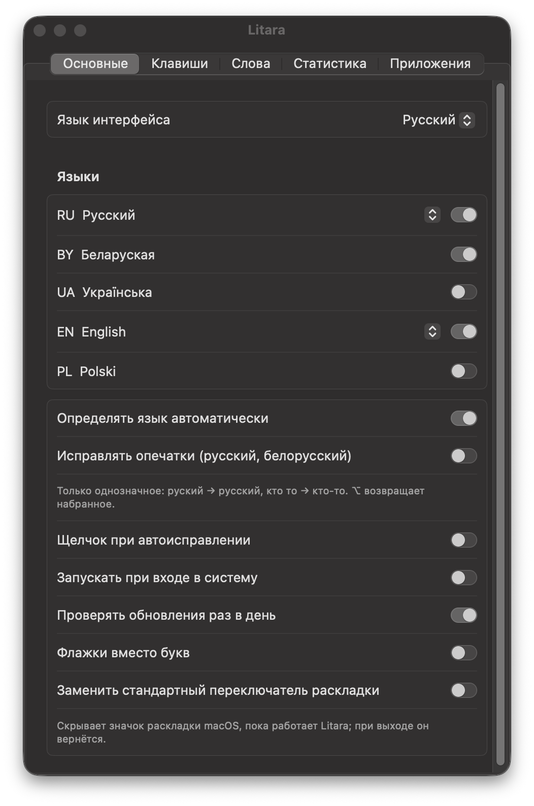
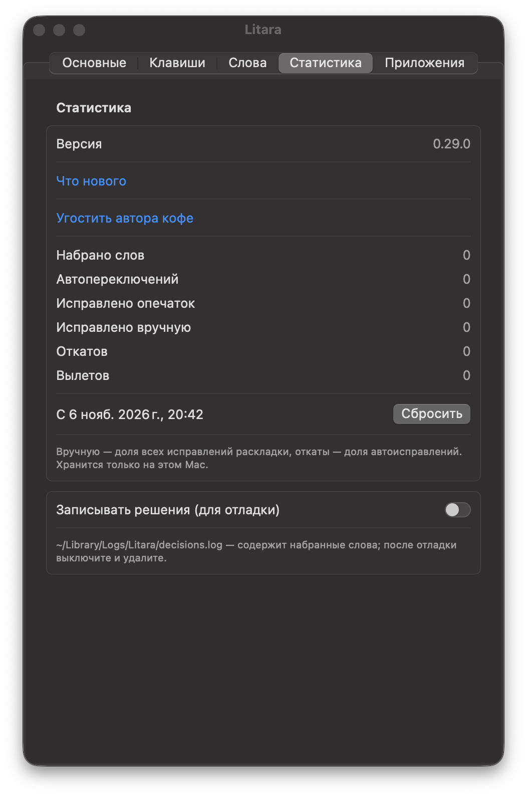

# Litara

[English](README.md) · [Беларуская](README.be.md) · [Polski](README.pl.md) · Русский · [Українська](README.uk.md)

[](https://github.com/Nugnii/litara/releases/latest)
[](https://www.swift.org/)
[](https://github.com/Nugnii/litara/releases/latest)
[](https://github.com/Nugnii/litara/releases)
[](LICENSE)

Litara исправляет на macOS текст, набранный не в той раскладке, и сама переключает раскладку. Набрали `ghbdtn`?
Получится `привет`. Набрали `руддщ`? Получится `hello`. Языки: белорусский, украинский, польский, русский и
английский. Бесплатная программа с открытым исходным кодом (GPL-3.0).

*Litara* по-белорусски «буква».

**[⬇️ Скачать Litara для macOS](https://github.com/Nugnii/litara/releases/latest/download/Litara.dmg)** — macOS 13 или
новее, Apple Silicon и Intel.

<p>
</p>

## ✨ Что умеет

- **Исправляет раскладку во время набора.** С третьей буквы или по пробелу слово, которое не имеет смысла в текущей
  раскладке, но есть в другой, перепечатывается в той раскладке, и раскладка переключается.
- **⌥ (нажать и отпустить)** — исправить последнее слово или выделенный текст; ещё раз — следующая раскладка.
  **⌥⇧** — следующая раскладка. Смену регистра и транслит можно назначить в настройках; любое сочетание
  можно изменить.
- **Отмена** — ⌥ сразу после исправления возвращает набранное. Слово, исправление которого отменено три раза, больше
  не исправляется и попадает в «Мои слова».
- **Исправляет опечатки** (русский и белорусский, по умолчанию выключено): только однозначные случаи — `руский` →
  `русский`, `кто то` → `кто-то`.
- **Учит ваши слова.** «Научить словам из текстов…» читает ваши собственные тексты (например, экспорт чата), чтобы
  узнавать имена, жаргон и ваш словарный запас; часто набираемые слова запоминаются сами. Выученные слова можно
  экспортировать и импортировать.
- **Мои слова, Свои замены, Приложения** — слова, которые никогда не исправляются, ваши собственные замены и
  приложения, в которых Litara сама ничего не исправляет.
- **Статистика** — набрано слов, автоматических исправлений, исправлено опечаток, исправлений по горячей клавише,
  отмен. Хранится только на вашем Mac.
- Значок в строке меню показывает текущий язык (буквами или флагами, как вам удобнее); интерфейс на белорусском,
  английском, польском, русском и украинском.

## 🧠 Как это работает

1. **Раскладки берутся из macOS.** Litara читает раскладки клавиатуры, установленные на вашем Mac, и знает, что
   печатает каждая клавиша в каждой из них. Ничего не зашито в код.
2. **Словари внутри приложения.** Словари Hunspell для пяти языков плюс имена и названия мест из Wikidata упакованы
   в компактные фильтры слов. Ни одно слово не ищется в сети.
3. **Она видит клавиши, а не документы.** С разрешением «Универсальный доступ» Litara видит нажатия клавиш и держит в
   памяти только текущее предложение. Ничего не записывается на диск и никуда не отправляется.
4. **Решает рано.** С третьей буквы, если набранное не может быть началом слова в текущем языке, но может в
   ровно одном другом, слово исправляется сразу; иначе Litara ждёт пробела. Белорусский, русский и украинский
   делят большинство клавиш, поэтому между ними решают словари каждого языка.
5. **Перепечатывает нажатиями клавиш.** Слово стирается Backspace и печатается заново в нужной раскладке, затем
   раскладка переключается. Буфер обмена никогда не затрагивается.
6. **Последнее слово за вами.** ⌥ исправляет или возвращает набранное; слово, исправление которого вы отменили три
   раза, больше никогда не исправляется.

### ⚠️ Ограничения

- Автоматическое определение охватывает белорусский, английский, польский, русский и украинский языки.
- Поля паролей никогда не затрагиваются. Пока в macOS включён защищённый ввод — даже если поле пароля осталось
  открытым в фоне — Litara приостанавливается и показывает замок в строке меню.
- В приложениях, где стирание доходит позже набора (например, в некоторых эмуляторах Android), Litara текст не
  правит; переключение раскладки при этом работает.
- Litara можно отключить для отдельных приложений на вкладке «Приложения».

## 📦 Установка

Нужна macOS 13 или новее, Apple Silicon или Intel.

1. Скачайте [Litara.dmg](https://github.com/Nugnii/litara/releases/latest/download/Litara.dmg) (все версии — в
   [Releases](https://github.com/Nugnii/litara/releases)) и перетащите Litara в «Программы». Программа подписана и
   проверена Apple (нотаризация).
2. Откройте Litara. Окно первого запуска попросит «Универсальный доступ»: «Системные настройки →
   Конфиденциальность и безопасность → Универсальный доступ», включите Litara. Без этого macOS не позволяет
   программе видеть набор.
3. При желании включите в настройках «Запускать при входе в систему».

Обновления: раз в день Litara проверяет, не вышла ли новая версия, и предлагает её установить; «Проверить
обновления…» есть в меню.

Переход с blalb (рабочее название Litara до 0.29.0): настройки, выученные слова и статистика переносятся при первом
запуске. «Универсальный доступ» придётся выдать заново: у приложения новый идентификатор.

## 🔒 Конфиденциальность

- Ничего из набранного не покидает ваш Mac. Статистика и выученные слова хранятся только на нём.
- Единственный сетевой запрос — ежедневная проверка обновлений на GitHub; ничего о вас и о набранном не передаётся.
  Отключается в «Основных».
- Буфер обмена не используется никогда: исправления перепечатываются нажатиями клавиш.
- Поля паролей не затрагиваются. Пока в macOS включён защищённый ввод, на значке в строке меню виден замок.
- «Записывать решения (для отладки)» по умолчанию выключено; журнал остаётся в `~/Library/Logs/Litara`.

## 🛠 Сборка из исходников

Нужен Xcode со Swift 6.

```sh
swift build
swift test
scripts/bundle.sh          # build/Litara.app, Apple Silicon and Intel
scripts/dmg.sh             # build/Litara-<version>.dmg
```

`scripts/bundle.sh` подписывает сертификатом Developer ID из связки ключей, если он есть, иначе ad hoc. Фильтры
слов пересобираются из словарей командой `scripts/build_dictionaries.sh`.

Раскладки читаются из macOS, а не зашиты в код. Требования: [docs/spec.md](docs/spec.md) (на русском). Изменения:
[CHANGELOG.md](CHANGELOG.md).

## 📚 Словари

Язык слова определяется по словарям Hunspell — SCOWL (en), словарь Александра Лебедева (ru), SJP.PL (pl), dict_uk
(uk) и белорусский словарь из LibreOffice (be) — и по именам и названиям мест из Wikidata. У каждого свой файл
лицензии; источники и лицензии: [Dictionaries/README.md](Dictionaries/README.md).

## 💬 Обратная связь

Пишите на [litaraby@gmail.com](mailto:litaraby@gmail.com) или открывайте
[issue](https://github.com/Nugnii/litara/issues).

Если Litara вам полезна, можно [угостить автора кофе](https://buycoffee.to/stugka).

## 📄 Лицензия

Copyright (C) 2026 Kanstantsin Berseneu

Это свободная программа: её можно распространять и изменять на условиях GNU General Public License, опубликованной
Free Software Foundation, версии 3 или (на ваш выбор) любой более поздней. См. [LICENSE](LICENSE).
