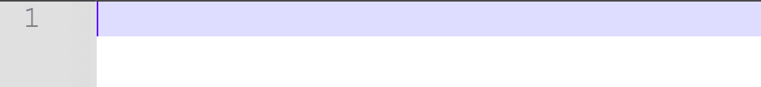
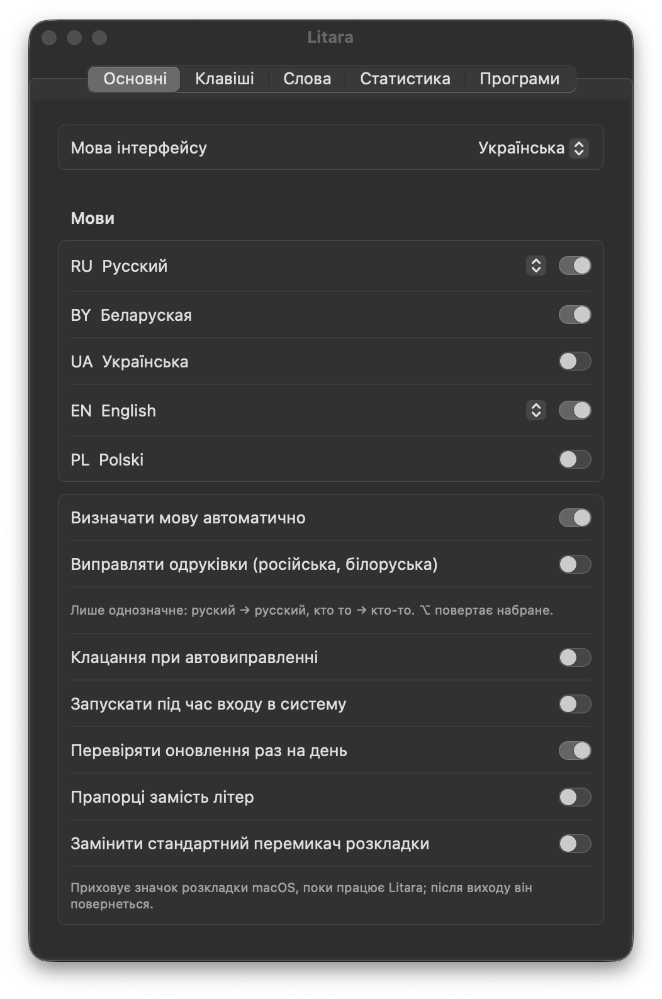
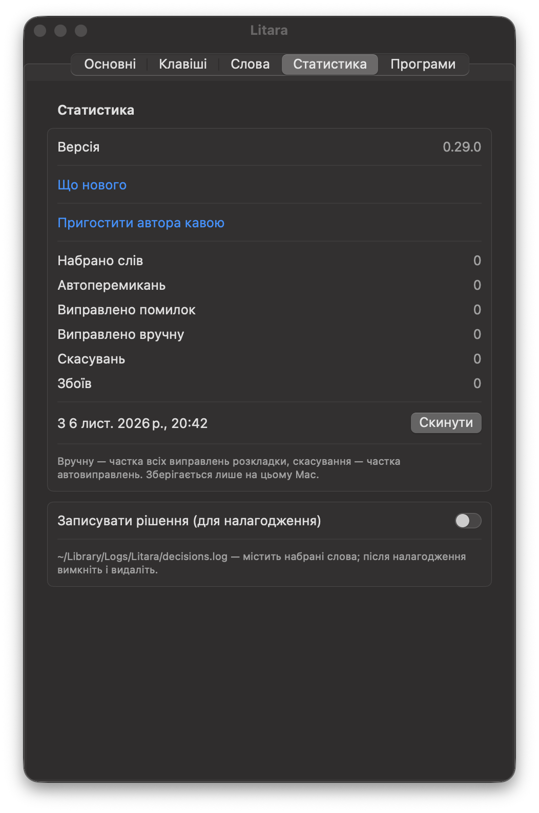

# Litara

[English](README.md) · [Беларуская](README.be.md) · [Polski](README.pl.md) · [Русский](README.ru.md) · Українська

[](https://github.com/Nugnii/litara/releases/latest)
[](https://www.swift.org/)
[](https://github.com/Nugnii/litara/releases/latest)
[](https://github.com/Nugnii/litara/releases)
[](LICENSE)

> Я не володію сліпим методом друку і втомився виправляти текст, набраний не в тій розкладці. Але наявні програми не
> підтримували білоруську мову й не мали тих функцій, які здавалися мені корисними: вони перемикали розкладку там, де
> це не було потрібно, і не було змоги якісно їх навчити. Довелося закасати рукави й виправити це.

Litara виправляє на macOS текст, набраний не в тій розкладці, і сама перемикає розкладку. Набрали `ghbdtn`?
Вийде `привет`. Набрали `руддщ`? Вийде `hello`. Мови: білоруська, українська, польська, російська та
англійська. Безкоштовна програма з відкритим кодом (GPL-3.0).

*Litara* білоруською означає «літера».

**[⬇️ Завантажити Litara для macOS](https://github.com/Nugnii/litara/releases/latest/download/Litara.dmg)** — macOS 13
або новіший, Apple Silicon та Intel.

<p></p>

<p>
</p>

## ✨ Що вміє

- **Виправляє розкладку під час набору.** З третьої літери або за пробілом слово, яке не має сенсу в поточній
  розкладці, але є в іншій, передруковується в тій розкладці, і розкладка перемикається.
- **⌥ (натиснути й відпустити)** — виправити останнє слово або виділений текст; ще раз — наступна розкладка.
  **⌥⇧** — наступна розкладка. Зміну регістру й транслітерацію можна призначити в налаштуваннях; кожне
  скорочення можна змінити.
- **Скасування** — ⌥ одразу після виправлення повертає набране. Слово, виправлення якого скасовано тричі, більше не
  виправляється і потрапляє до «Мої слова».
- **Виправляє помилки друку** (російська та білоруська, типово вимкнено): лише однозначні випадки — `руский` →
  `русский`, `кто то` → `кто-то`.
- **Вчить ваші слова.** «Навчити словам з текстів…» читає ваші власні тексти (наприклад, експорт чату), щоб
  розпізнавати імена, сленг і ваш словник; слова, які ви часто набираєте, вивчаються самі. Вивчені слова можна
  експортувати та імпортувати.
- **«Мої слова», «Свої заміни», «Програми»** — слова, які ніколи не виправляються, ваші власні заміни та програми, де
  Litara сама нічого не виправляє.
- **Статистика** — набрано слів, автоматичних виправлень, виправлено помилок друку, виправлень гарячою клавішею,
  скасувань. Зберігається лише на вашому Mac.
- Значок у рядку меню показує поточну мову (літерами або, якщо хочете, прапорцями); інтерфейс — білоруською,
  англійською, польською, російською та українською.

## 🧠 Як це працює

1. **Розкладки беруться з macOS.** Litara читає розкладки клавіатури, встановлені на вашому Mac, і знає, що друкує
   кожна клавіша в кожній із них. Нічого не зашито в код.
2. **Словники всередині програми.** Словники Hunspell для п'яти мов, а також імена й назви місць з Wikidata
   упаковано в компактні фільтри слів. Жодне слово не шукається в інтернеті.
3. **Вона бачить клавіші, а не документи.** Маючи доступ «Доступність», Litara бачить натискання клавіш і тримає в
   пам'яті лише поточне речення. Нічого не записується на диск і нікуди не надсилається.
4. **Вирішує рано.** З третьої літери, якщо набране не може бути початком слова в поточній мові, але може бути
   рівно в одній іншій, слово виправляється одразу; інакше Litara чекає на пробіл. Білоруська, російська та
   українська мають багато спільних клавіш, тож між ними вирішують словники кожної мови.
5. **Передруковує натисканнями клавіш.** Слово стирається Backspace і набирається знову в потрібній розкладці, після
   чого розкладка перемикається. Буфер обміну не чіпається ніколи.
6. **Ви керуєте процесом.** ⌥ виправляє або повертає набране; слово, виправлення якого скасовано тричі, більше ніколи
   не виправляється.

### ⚠️ Обмеження

- Автоматичне визначення охоплює білоруську, англійську, польську, російську та українську мови.
- Поля паролів не чіпаються ніколи. Поки в macOS увімкнено захищене введення — навіть якщо поле пароля лишилося
  відкритим у тлі, — Litara призупиняється й показує замок у рядку меню.
- У програмах, де стирання доходить пізніше за набір (наприклад, у деяких емуляторах Android), Litara не редагує
  текст; перемикання розкладки працює й там.
- Litara можна вимкнути для окремих програм у розділі «Програми».

## 📦 Встановлення

Потрібен macOS 13 або новіший, Apple Silicon чи Intel.

1. Завантажте [Litara.dmg](https://github.com/Nugnii/litara/releases/latest/download/Litara.dmg) (усі версії — на
   сторінці [Releases](https://github.com/Nugnii/litara/releases)) і перетягніть Litara до «Програм». Програму
   підписано й нотаризовано Apple.
2. Відкрийте Litara. Вікно першого запуску попросить доступ «Доступність»: «Системні параметри → Приватність і
   безпека → Доступність», увімкніть Litara. Без цього macOS не дозволяє програмі бачити набір.
3. За бажання увімкніть у налаштуваннях «Запускати під час входу в систему».

Оновлення: раз на день Litara перевіряє, чи вийшла нова версія, і пропонує її встановити; «Перевірити оновлення…» —
у меню.

Перехід із blalb (робоча назва Litara до 0.29.0): налаштування, вивчені слова та статистика переносяться під час
першого запуску. Доступ «Доступність» потрібно надати заново: у програми новий ідентифікатор.

## 🔒 Приватність

- Ніщо з набраного не залишає ваш Mac. Статистика та вивчені слова зберігаються лише на ньому.
- Єдиний мережевий запит — щоденна перевірка оновлень на GitHub; нічого про вас і набране не надсилається.
  Вимикається в «Основних».
- Буфер обміну не використовується ніколи: виправлення передруковуються натисканнями клавіш.
- Поля паролів не чіпаються. Поки в macOS увімкнено захищене введення, на значку в рядку меню — замок.
- «Записувати рішення (для налагодження)» типово вимкнено; журнал залишається в `~/Library/Logs/Litara`.

## 🛠 Збирання з вихідного коду

Потрібен Xcode зі Swift 6.

```sh
swift build
swift test
scripts/bundle.sh          # build/Litara.app, Apple Silicon and Intel
scripts/dmg.sh             # build/Litara-<version>.dmg
```

`scripts/bundle.sh` підписує сертифікатом Developer ID зі зв'язки ключів, якщо він є, інакше — ad hoc. Фільтри
слів перебудовуються зі словників за допомогою `scripts/build_dictionaries.sh`.

Розкладки читаються з macOS, а не зашиті в код. Вимоги — [docs/spec.md](docs/spec.md) (російською). Зміни —
[CHANGELOG.md](CHANGELOG.md).

## 📚 Словники

Мова слова визначається за словниками Hunspell — SCOWL (en), словник Олександра Лебедєва (ru), SJP.PL (pl), dict_uk
(uk) і білоруський словник із LibreOffice (be) — а також за іменами та назвами місць з Wikidata. Кожен має власний
файл ліцензії; джерела та ліцензії — [Dictionaries/README.md](Dictionaries/README.md).

## 💬 Зворотний зв'язок

Пишіть на [litaraby@gmail.com](mailto:litaraby@gmail.com) або відкривайте
[issue](https://github.com/Nugnii/litara/issues).

Якщо Litara вам корисна, можете [пригостити автора кавою](https://buycoffee.to/stugka).

## 📄 Ліцензія

Copyright (C) 2026 Kanstantsin Berseneu

Це вільна програма: її можна поширювати та змінювати на умовах GNU General Public License, опублікованої Free
Software Foundation, версії 3 або (на ваш вибір) будь-якої пізнішої. Дивіться [LICENSE](LICENSE).
